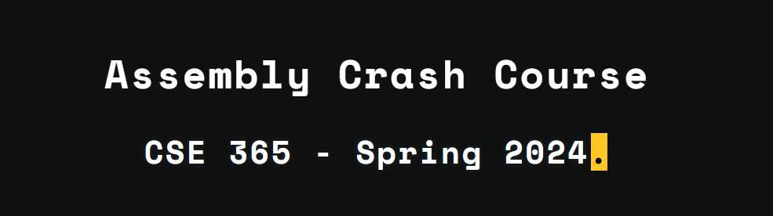

# Assembly Crash Course
 - **Challenge:** Assembly Level 1 -> 30
- **Category:** Programming languages
- **Difficulty:** Easy
- **Source**: [pwn.college](https://pwn.college/computing-101/assembly-crash-course/)
-Note:Đây là write up thứ hai của mình trong hành trình thi đấu ```ctf``` nói chung và ```pwnable``` nói riêng. Một công cụ hay một nền tảng để luyện tập là vô cùng cần thiết, do đó mình sẽ chọn hoàn thành các level của ```pwn college```, cung cấp các bài học rất trực quan  dễ tiếp cận cho người mới bắt đầu. Hy vọng bài viết này sẽ cung cấp tư liệu tốt cho mọi người tham khảo.





Và trước khi bắt đầu mình có 1 vài docs và video liên quan đến Assembly các bạn có thể đọc thử tại đây:
- [LiveOverflow](https://www.youtube.com/watch?v=iyAyN3GFM7A&list=PLhixgUqwRTjxglIswKp9mpkfPNfHkzyeN&index=1)
- [Comprehensive assembly tutorial](https://github.com/mytechnotalent/Reverse-Engineering-Tutorial)
- [Architecture 1001: x86-64 Assembly](https://ost2.fyi/Arch1001)
- [x86_64 assembly book](https://open.umn.edu/opentextbooks/textbooks/733)
- ...vv
